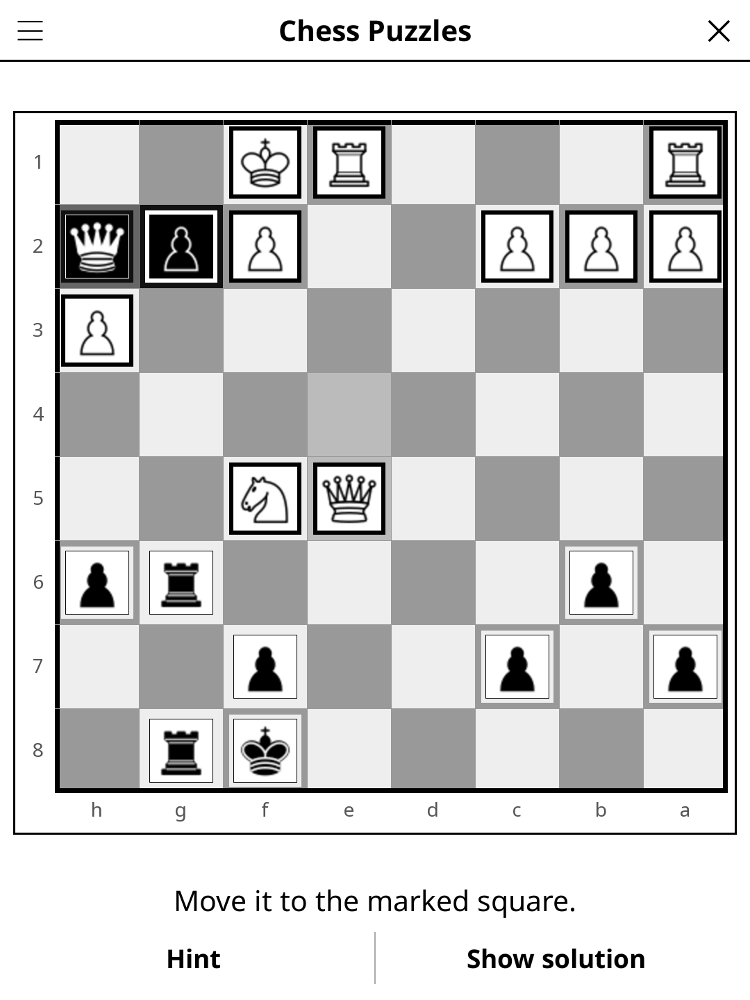

# chesspuzzles.koplugin

**Chess Puzzles** (FR « Problèmes d'échecs ») — rated chess tactics for
[KOReader](https://github.com/koreader/koreader): find the winning move in
positions taken from real games.

## Screenshot



## Rules

1. The board is shown right after your opponent's move (highlighted). You
   play the side to move; your pieces are at the bottom.
2. Find the best move. A right move is answered by your opponent; keep going
   until the puzzle is solved. Any move that checkmates is accepted, even if
   it is not the one in the recorded solution.
3. A wrong move is crossed out and the position stays as it was: try again.
   The puzzle then counts as failed for your rating.

## Features

- **10,000 puzzles** from the Lichess puzzle database, 2,000 per difficulty:
  *Beginner* (under 1000), *Easy* (1000–1399), *Medium* (1400–1799),
  *Hard* (1800–2199), *Expert* (2200 and up). Only well-established puzzles
  are kept: low rating deviation, popularity ≥ 90 %, at least 1,000 plays.
- **Your rating** — starts at 1200 and moves with each puzzle (Elo against
  the puzzle's rating, with a K factor that settles as you play). A puzzle
  only counts the first time; a wrong move, a hint or the solution makes it a
  loss. Streak and best streak, solved/failed counts (*Statistics*).
- **Adaptive** difficulty picks puzzles near your rating; or stay in one
  band.
- **Themes**: all, mate in 1, 2 or 3+, forks, pins, skewers, discovered
  attacks, sacrifices, endgames, promotion.
- **No repeats** — puzzles you have played are not offered again until every
  matching one has been seen.
- **Hint** — first tap marks the piece to move, second tap its target square.
- **Show solution** — gives up and steps through the rest of the solution,
  forwards and back.
- Promotion choice, board flip, **Daily Challenge** (the same puzzle for
  everyone today) and auto-save of the puzzle in progress.

## Multiplayer

**Chess Puzzles · multiplayer** (Tools → Games → Party & quiz, or *Mode:
Multiplayer* in the menu): 2 to 8 players — or teams (*Play as: Teams*) —
solve puzzles on one board laid on the table.

- Each puzzle has a clock (1, 2, 3 or 5 minutes, or no limit). Whoever has
  it taps **I have it!** (or the board), picks their name in **Who has it?**
  and plays the moves. The clock stops during an attempt.
- **Points**: Beginner 1, Easy 2, Medium 3, Hard 4, Expert 5, plus 1 for each
  move to find beyond the first; each hint (shared, between attempts) takes 1
  off, never below 1.
- A **wrong move** puts that player out for this puzzle: the position goes
  back to the start and the others may try. Everyone out, time up or *Show
  solution*: nobody scores, and the solution can be stepped through.
- A match is 3, 5 or 10 puzzles from the chosen difficulty; scores after
  each, the best total wins (ties possible).
- Multiplayer never changes your solo rating, statistics or seen puzzles.
  The match in progress is saved apart from the solo puzzle.

## Controls

| Action | How |
|--------|-----|
| Move a piece | Tap it (dots mark its legal moves), then tap the target square |
| Hint / Show solution | Buttons under the board |
| New game, Daily Challenge, difficulty, theme, flip, statistics, rules | Title-bar menu |

## Puzzle data and credit

Puzzles from the [Lichess puzzle database](https://database.lichess.org/#puzzles),
released under **CC0** (public domain). Each puzzle keeps its Lichess id, so
you can look one up at `https://lichess.org/training/<id>` — for example
[lichess.org/training/2Nw2a](https://lichess.org/training/2Nw2a). The plugin
itself never uses the network.

The shipped files (`puzzles_<band>.lua`, one per difficulty, loaded only when
needed) are built offline by `tools/` (not shipped):

```sh
curl -s https://database.lichess.org/lichess_db_puzzle.csv.zst \
    | zstd -dc | head -n 500000 > puzzles_head.csv
python3 tools/select_puzzles.py puzzles_head.csv .
lua tools/check_puzzles.lua     # replays every move of every puzzle
```

## Why e-ink friendly?

Grey squares and boxed black-and-white pieces; hints invert a square, a wrong
move gets a bold cross, the last move a flat grey. No animation: the
opponent's answer lands after a short pause, one repaint each.

## License

GPL-3.0 (code). Puzzle data: CC0, from lichess.org.
